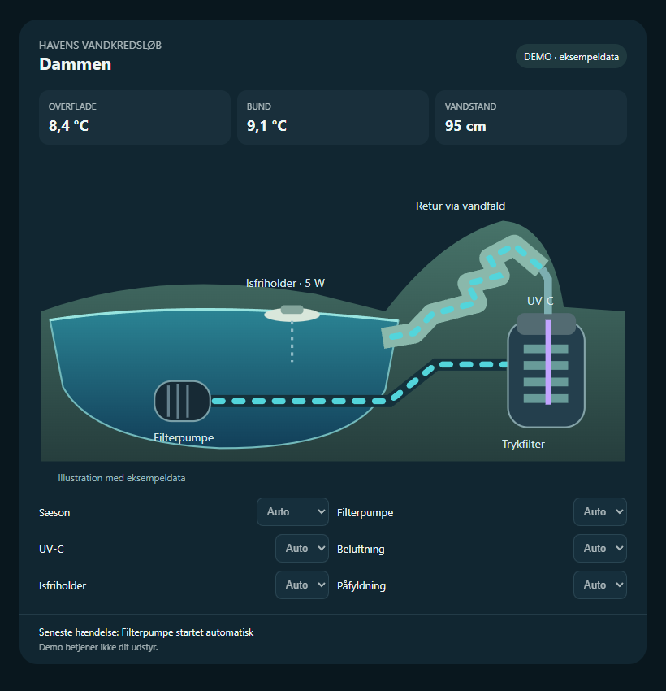

# Pond Flow Card

SVG-kort til Home Assistant med dam, filterpumpe, trykfilter med UV-C, retur via vandfald og separat IceFree 4 Seasons-isfriholder. Første version 0.1.0.



[Tilføj repoet i HACS](https://my.home-assistant.io/redirect/hacs_repository/?owner=MEbsen&repository=pond-flow-card&category=plugin).

## Installation med HACS

Tilføj GitHub-repoet som et brugerdefineret repository med typen **Dashboard**, download kortet, og kontrollér at ressourcen er registreret som JavaScript-modul:

```text
/hacsfiles/pond-flow-card/pond-flow-card.js
```

Tilføj derefter et manuelt dashboardkort. Entity-id'erne nedenfor er eksempler og skal erstattes med dine faktiske entiteter:

```yaml
type: custom:pond-flow-card
title: Dammen
entities:
  status: sensor.pond_status
  temp_surface: sensor.pond_temperature_surface
  temp_bottom: sensor.pond_temperature_bottom
  water_level: sensor.pond_water_level
  pump_running: binary_sensor.pond_pump_running
  uv_running: binary_sensor.pond_uv_running
  last_event: sensor.pond_last_event
  season: select.pond_season
  pump_mode: select.pond_pump_mode
  uv_mode: select.pond_uv_mode
  aerator_mode: select.pond_aerator_mode
  fill_mode: select.pond_fill_mode
  # icefree_mode tilføjes, når controlleren understøtter den.
```

Vælg `demo: true` uden entiteter for en tydeligt markeret visning med eksempeldata og deaktiveret betjening. Åbn `preview.html` via en lokal HTTP-server for en selvstændig demo.

Kortet bruger eksisterende `select`-entiteter og deres tilgængelige valgmuligheder. Manglende eller utilgængelige entiteter kan ikke betjenes. Animationen følger pumpens statusentitet og dokumenterer ikke faktisk vandgennemstrømning. Den selvstændige isfriholder er tegnet ind, men kræver særskilt controllerunderstøttelse til styring. Kortet viser endnu ikke hele controllerens alarmoversigt, driftstider eller indstillinger; dette er første version.

## Udgivelse

JavaScript leveres direkte uden buildtrin eller eksterne browserafhængigheder. GitHub Actions kontrollerer JavaScript og HACS-format. Et push af et versions-tag som `v0.1.0` opretter en release med `pond-flow-card.js`, som HACS kan hente. Installation eller opdatering i den konkrete HA-instans kræver adgang til den instans.

ESPHome-filen med lokale adgangsnøgler og referencebilledet er udeladt fra Git. Se `Projekt.md` for udstyr og afklaringer.
